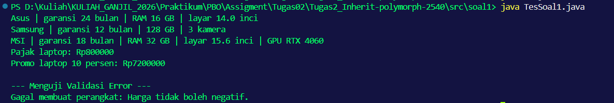
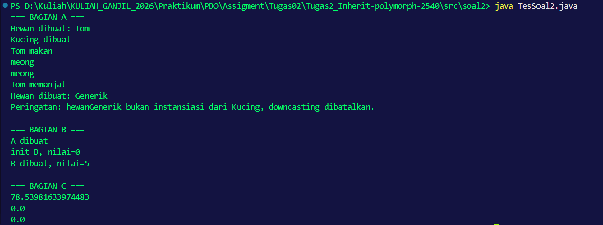
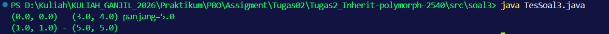
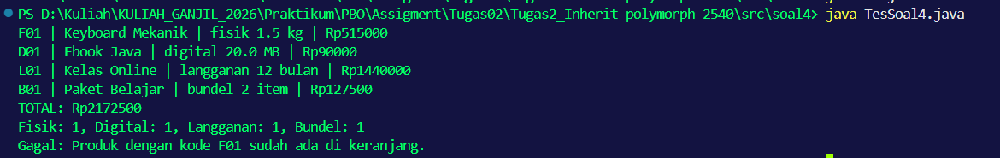

# Tugas 2 Praktikum PBO

- **Nama Lengkap:** Najahal Khaira
- **NPM:** 250810701100040
- **Kelas:** Praktikum PBO A
- **Repository GitHub:** [https://github.com/Najahal/Tugas2_Inherit-polymorph-2540]

## Deskripsi Singkat

Repositori ini berisi penyelesaian Tugas 2 Praktikum Pemrograman Berorientasi Objek (PBO) yang berfokus pada penerpan konsep hierarki _Inheritance_, _Polymorphism_ (Dynamic Method Dispatch), _Composition_ (has-a), penanganan eksepsi (_Exception Handling_), serta teknik pencegahan kebocoran status objek (_Defensive Copying_).

---

## Fitur Utama

- **Soal 1 (Hierarki Perangkat Elektronik):** Manajemen perangkat elektronik (Laptop, Ponsel, Laptop Gaming) dengan perhitungan harga dasar, diskon, garansi, serta _overriding_ deskripsi spesifik.
- **Soal 2 (Analisis Polimorfisme & Downcasting):** Pembuktian penanganan error _downcasting_ menggunakan `instanceof` serta analisis eksekusi _constructor_ dan _Liskov Substitution Principle_ (LSP).
- **Soal 3 (Komposisi Titik & Garis):** Perhitungan geometri garis berorientasi objek yang menerapkan _composition_ murni dan _defensive copy_ pada _constructor_ untuk mencegah masalah _aliasing_.
- **Soal 4 (Mini Project Toko Digital):** Sistem keranjang belanja yang mengelola _ProdukFisik_, _ProdukDigital_, _Langganan_, serta paket opsional _ProdukBundel_ dilengkapi proteksi kode unik dan perhitungan otomatis.

---

## Konsep OOP yang Diterapkan

| Nama Konsep             | Lokasi Penerapan                   | Alasan Pemilihan                                                                                                       |
| :---------------------- | :--------------------------------- | :--------------------------------------------------------------------------------------------------------------------- |
| **Inheritance (is-a)**  | `ProdukDigital extends Produk`     | Memanfaatkan pewarisan atribut umum (`kode`, `nama`, `hargaDasar`) untuk menghindari duplikasi kode.                   |
| **Composition (has-a)** | `Garis` memuat `Titik`             | Menggambarkan bahwa garis terbentuk atas dua koordinat titik, bukan turunan dari titik.                                |
| **Polymorphism**        | `Keranjang.hitungTotal()`          | Mengeksekusi `hitungHargaAkhir()` secara dinamis tanpa perlu mengecek tipe spesifik objek (_Dynamic Method Dispatch_). |
| **Defensive Copy**      | `Garis(Titik, Titik)`              | Menyalin instansiasi titik baru agar referensi memori internal `Garis` aman dari pengubahan luar (_aliasing_).         |
| **Safe Downcasting**    | `Keranjang.hitungPerJenis()`       | Memastikan tipe objek aktual sebelum dipaksa turun tipe (_downcast_) untuk menghindari `ClassCastException`.           |
| **Exception Handling**  | `Keranjang.tambah()` & Constructor | Melempar `IllegalStateException` jika terjadi duplikasi kode dan `IllegalArgumentException` pada input tak valid.      |

---

## Struktur Project

```text
Tugas2_Inherit-polymorph-Npmawalakhir/
├── src/
│   ├── soal1/
│   │   ├── Perangkat.java
│   │   ├── Laptop.java
│   │   ├── Ponsel.java
│   │   ├── LaptopGaming.java
│   │   └── TesSoal1.java
│   ├── soal2/
│   │   ├── Hewan.java
│   │   ├── Kucing.java
│   │   ├── A.java
│   │   ├── B.java
│   │   ├── Lingkaran.java
│   │   ├── Titik.java
│   │   └── TesSoal2.java
│   ├── soal3/
│   │   ├── Titik.java
│   │   ├── Garis.java
│   │   └── TesSoal3.java
│   └── soal4/
│       ├── Produk.java
│       ├── ProdukFisik.java
│       ├── ProdukDigital.java
│       ├── Langganan.java
│       ├── ProdukBundel.java
│       ├── Keranjang.java
│       └── TesSoal4.java
├── .gitignore
└── README.md
```

---

## Prasyarat

1. Java Development Kit (JDK): Versi 11 atau lebih baru (Disarankan JDK 17/21).
2. IDE: IntelliJ IDEA / Visual Studio Code / Eclipse.

---

## Cara Menjalankan Program

### Melalui Command Line (Terminal)

Buka terminal di root directory proyek, lalu jalankan perintah kompilasi dan eksekusi per soal:

---

**Soal 1:**

```text
javac src/soal1/*.java
java -cp src soal1.TesSoal1
```

**Soal 2:**

```text
javac src/soal2/*.java
java -cp src soal2.TesSoal2
```

**Soal 3:**

```text
javac src/soal3/*.java
java -cp src soal3.TesSoal3
```

**Soal 4:**

```text
javac src/soal4/*.java
java -cp src soal4.TesSoal4
```

### Melalui Command Line (Terminal)

1. Buka folder proyek di IntelliJ IDEA.
2. Pastikan folder src ditandai sebagai Sources Root (Klik kanan src > Mark Directory as > Sources Root).
3. Jalankan file main masing-masing soal (TesSoal1.java, TesSoal2.java, dll.) dengan menekan tombol Run (Shift + F10).

---

## Contoh Output

### Soal 1: Perangkat Elektronik



```text
Asus | garansi 24 bulan | RAM 16 GB | layar 14.0 inci
Samsung | garansi 12 bulan | 128 GB | 3 kamera
MSI | garansi 18 bulan | RAM 32 GB | layar 15.6 inci | GPU RTX 4060
Pajak laptop: Rp800000
Promo laptop 10 persen: Rp7200000

--- Menguji Validasi Error ---
Gagal membuat perangkat: Harga tidak boleh negatif.
```

### Soal 2: Analisis Polimorfisme & Downcasting



```text
=== BAGIAN A ===
Hewan dibuat: Tom
Kucing dibuat
Tom makan
meong
meong
Tom memanjat
Hewan dibuat: Generik
Peringatan: hewanGenerik bukan instansiasi dari Kucing, downcasting dibatalkan.

=== BAGIAN B ===
A dibuat
init B, nilai=0
B dibuat, nilai=5

=== BAGIAN C ===
78.53981633974483
0.0
0.0
```

### Soal 3: Titik dan Garis



```text
(0.0, 0.0) - (3.0, 4.0) panjang=5.0
(1.0, 1.0) - (5.0, 5.0)
```

### Soal 4: Mini Project Toko Digital



```text
F01 | Keyboard Mekanik | fisik 1.5 kg | Rp515000
D01 | Ebook Java | digital 20.0 MB | Rp90000
L01 | Kelas Online | langganan 12 bulan | Rp1440000
B01 | Paket Belajar | bundel 2 item | Rp127500
TOTAL: Rp2172500
Fisik: 1, Digital: 1, Langganan: 1, Bundel: 1
Gagal: Produk dengan kode F01 sudah ada di keranjang.
```
---

# Jawaban Soal dan Analisis Konsep

## Soal 1: Hierarki Perangkat Elektronik

**Pertanyaan Tambahan:**
Ubah harga menjadi `private` lalu kompilasi. Salin pesan error yang muncul dan jelaskan mengapa error tersebut muncul.

**Pesan Error:**
`error: harga has private access in soal1.Perangkat`

**Penjelasan:**
Saat modifier atribut `harga` diubah dari `protected` menjadi `private` pada kelas `Perangkat`, atribut tersebut dikapsulasi murni dan hanya dapat diakses dari dalam kelas `Perangkat` itu sendiri. Subclass seperti `Laptop` kehilangan hak akses langsung ke atribut tersebut. Akibatnya, saat method `hitungHargaPromo()` di kelas `Laptop` mencoba mengakses variabel `harga` untuk melakukan perhitungan diskon, _compiler_ Java menolaknya dan menghasilkan error kompilasi.

## Soal 2: Analisis Output, Error, dan Polimorfisme

**1. Output Lengkap Program**
Berdasarkan eksekusi dengan penambahan _error handling_ (`instanceof`), berikut adalah output program sampai berhenti:

```text
=== BAGIAN A ===
Hewan dibuat: Tom
Kucing dibuat
Tom makan
meong
meong
Tom memanjat
Hewan dibuat: Generik
Peringatan: hewanGenerik bukan instansiasi dari Kucing, downcasting dibatalkan.

=== BAGIAN B ===
A dibuat
init B, nilai=0
B dibuat, nilai=5

=== BAGIAN C ===
78.53981633974483
0.0
0.0
```

**2. Error pada h.panjat()**
Jika komentar dihapus, akan terjadi error kompilasi (compile-time error) dengan pesan cannot find symbol method panjat(). Hal ini terjadi karena tipe referensi (tipe statis) dari variabel h adalah Hewan. Compiler Java hanya memeriksa ketersediaan method berdasarkan tipe statisnya, dan kelas Hewan tidak memiliki method panjat().

**3. Penyebab ClassCastException dan Perbaikannya**
Error terjadi pada baris Kucing k2 = (Kucing) h2; (sebelum diperbaiki). Objek h2 diinstansiasi langsung sebagai Hewan, bukan Kucing, sehingga tidak bisa di-downcast paksa. Perbaikannya dilakukan dengan mengecek instansiasi menggunakan instanceof tanpa mengubah tipe variabel h2:

```text
if (h2 instanceof Kucing) {
    Kucing k2 = (Kucing) h2;
    k2.panjat();
} else {
    System.out.println("Peringatan: h2 bukan Kucing, downcasting dibatalkan.");
}
```

**4. Konsep Tipe Statis dan Dinamis pada h.makan()**
Method suara() yang dijalankan adalah milik kelas Kucing. Pada variabel h, tipe statisnya adalah Hewan (yang dicek saat kompilasi), tetapi tipe dinamisnya (wujud objek aslinya di memori saat runtime) adalah Kucing. Java menggunakan mekanisme Dynamic Method Dispatch, sehingga method yang dipanggil adalah method yang telah di-override pada tipe dinamisnya.

**5. Analisis Output new B() dan Risiko Overriding di Constructor**
Nilai pada baris init B adalah 0, bukan 5.
Saat new B() dipanggil, constructor superclass (A) dieksekusi lebih dulu. Constructor A memanggil method init(). Karena objek aktualnya adalah B, method init() milik B yang dijalankan. Namun, atribut nilai di kelas B belum diinisialisasi (masih bernilai default int yaitu 0). Memanggil method yang bisa di-override dari dalam constructor berisiko karena method subclass dapat tereksekusi sebelum status objek subclass tersebut diinisialisasi sepenuhnya, yang berpotensi memicu NullPointerException atau logical error.

**6. Analisis Relasi is-a Titik dan Lingkaran**
Pemanggilan l3.luas() menghasilkan 0.0 karena tipe dinamis l3 adalah Titik, sehingga method luas() yang dijalankan adalah hasil override milik Titik.
Meskipun secara geometri "Titik adalah sebuah Lingkaran dengan jari-jari 0", dalam Pemrograman Berorientasi Objek (OOP) relasi is-a ini melanggar Liskov Substitution Principle (LSP). Konsekuensinya, jika sebuah sistem mengharapkan objek Lingkaran yang selalu memiliki luas lebih dari nol (misalnya sebagai pembagi dalam perhitungan kepadatan), memasukkan objek Titik akan merusak logika program dan memicu error seperti pembagian dengan nol (DivisionByZero). Subclass tidak boleh mengubah ekspektasi dasar dari superclass-nya.

## Soal 3: Titik dan Garis

**1. Prediksi Output Baris Kedua (Sebelum Perbaikan / Konsep Aliasing)**
Jika _defensive copy_ belum diterapkan pada constructor `Garis`, pengubahan nilai `t.setX(100)` akan memicu efek _aliasing_. Karena `Garis g2` dan variabel `t` merujuk pada alamat memori objek yang sama, perubahan pada `t` akan "bocor" ke dalam `g2`.
Output yang diprediksi dan tercetak pada baris kedua adalah: `(100.0, 1.0) - (5.0, 5.0)`.

**2. Output Setelah Perbaikan (Penerapan Defensive Copy)**
Setelah constructor `Garis` diubah menggunakan _defensive copy_ (menginstansiasi objek `Titik` baru dengan nilai yang disalin, bukan sekadar menyalin referensi memori), perubahan pada objek `t` di luar kelas tidak lagi memengaruhi status internal `Garis g2`.
Output yang tercetak menjadi: `(1.0, 1.0) - (5.0, 5.0)`.

**3. Kapan masing-masing perilaku lebih tepat?**

- **Sebelum Perbaikan (Aliasing / Shallow Copy):** Lebih tepat digunakan jika sistem membutuhkan sinkronisasi data _real-time_ atau _shared state_. Contohnya, pada sistem visualisasi _live tracking_ rute taksi online; jika posisi mobil (Titik) bergerak, rute (Garis) di layar harus otomatis ikut bergeser mengikuti titik tersebut tanpa perlu pembaruan manual.
- **Sesudah Perbaikan (Defensive Copy / Deep Copy):** Lebih tepat digunakan jika integritas dan keamanan data menjadi prioritas (objek bersifat _immutable_). Contohnya, sistem pemetaan batas sertifikat tanah; koordinat batas (Titik) tidak boleh berubah secara tak sengaja hanya karena objek di luar sistem memodifikasi nilainya.

**4. Masalah Desain jika Garis extends Titik (Relasi is-a vs has-a)**
Jika `Garis` dibuat dengan melakukan `extends Titik`, kita memaksakan relasi _is-a_ ("Garis adalah sebuah Titik"). Secara logika geometri umum dan desain berorientasi objek (OOP), hal ini salah arah dan melanggar aturan dasar. Garis tidak berwujud sebagai satu titik tunggal, melainkan **dibentuk oleh** dua titik, yang mana ini adalah ranah relasi _has-a_ (Komposisi).
Secara teknis, jika di-_extends_, `Garis` akan mewarisi atribut tunggal `x` dan `y` milik `Titik`, padahal sebuah garis mutlak membutuhkan dua set koordinat (titik awal dan titik akhir) untuk dapat eksis dan dihitung panjangnya.

## Bagian Analisis Konsep

**1. Perbedaan Method Overriding dan Method Overloading**
Method _overriding_ terjadi ketika subclass mendefinisikan ulang method dari superclass dengan nama dan parameter yang sama persis untuk mengubah perilakunya, yang merupakan bentuk polimorfisme _runtime_. Contohnya pada kode adalah method `hitungHargaAkhir()` di kelas `ProdukFisik` yang menimpa logika method bawaan dari kelas `Produk` untuk menambahkan ongkos kirim. Sebaliknya, method _overloading_ terjadi ketika terdapat beberapa method dengan nama yang sama namun parameter yang berbeda di dalam sebuah kelas, yang mewakili polimorfisme _compile-time_. Contoh _overloading_ di tugas ini adalah ketersediaan dua _constructor_ pada kelas `Garis`, di mana satu menerima dua objek `Titik` dan yang lainnya menerima empat nilai _double_.

**2. Pemilihan Inheritance dan Composition**
_Inheritance_ dipilih ketika dua objek murni memiliki relasi _is-a_ ("adalah sebuah"), di mana subclass mewarisi karakteristik inti dari superclass untuk kemudian dikembangkan lebih spesifik. Contohnya pada tugas ini adalah `ProdukDigital extends Produk`, karena sebuah _ebook_ (produk digital) sudah pasti "adalah sebuah" produk yang memiliki nama dan harga. Sementara itu, _composition_ dipilih ketika terdapat relasi _has-a_ ("memiliki sebuah"), di mana suatu objek disusun oleh satu atau beberapa objek lain tanpa mewarisi sifatnya. Contoh _composition_ di tugas ini adalah kelas `Garis` yang memiliki komponen objek `Titik` (awal dan akhir), karena secara logika garis bukanlah sebuah titik, melainkan dibentuk oleh titik.

**3. Penggunaan instanceof dan Keamanan Downcasting (Soal 4)**
Method `cetakStruk()` tidak memerlukan `instanceof` karena murni memanfaatkan polimorfisme dinamis, di mana Java secara otomatis memanggil versi _override_ dari method `hitungHargaAkhir()` dan `deskripsi()` sesuai wujud asli masing-masing objek. Sebaliknya, `hitungPerJenis()` wajib menggunakan `instanceof` karena method tersebut butuh membedakan identitas kelas secara spesifik untuk dikelompokkan dan dihitung jumlahnya, bukan untuk menjalankan perilakunya. Terkait _downcasting_ (memaksa referensi objek turun menjadi tipe subclass tertentu), hal ini tidak selalu aman karena jika objek aslinya bukan merupakan instansiasi dari subclass yang dituju, Java akan melemparkan _error_ `ClassCastException`. Oleh karena itu, kita selalu harus memastikan kecocokannya dengan `instanceof` sebelum melakukan _downcasting_ agar program tidak hancur saat _runtime_.

## Batasan dan Pengembangan Lanjutan

1. Batasan: Penyimpanan data keranjang belanja saat ini masih berbasis memori (volatile) menggunakan ArrayList dan belum terintegrasi dengan basis data eksternal.
2. Pengembangan Lanjutan: Dapat ditambahkan fitur persistence layer (seperti integrasi database SQL/NoSQL), antarmuka GUI (JavaFX/Swing), serta penanganan mata uang multi-currency.
